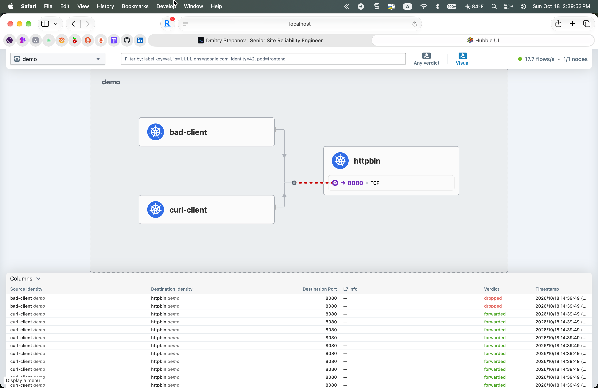

# cilium-l7-observability

L7 observability with Cilium + Hubble on Oracle Cloud Ampere A1 (ARM64).

Single-node k3s with Cilium CNI, Hubble UI, Hubble metrics, and a demo
workload (httpbin + two clients) that shows identity-based network policy
enforcement with per-flow visibility.

## Stack

- Oracle Cloud Ampere A1 Always Free (2 OCPU, 12 GB RAM, Ubuntu 24.04)
- k3s v1.36.5, single-node, no flannel, no built-in network-policy
- Cilium v1.17.7 (CNI + Hubble + Prometheus metrics)
- `mccutchen/go-httpbin` as the demo backend
- `nicolaka/netshoot` as demo clients

## What the demo shows



Namespace `demo` with three deployments:

- `httpbin` - backend, exposes `/get`, `/headers`, `/admin`, `/secret`
- `curl-client` - allowed caller, hits `/get` and `/headers`
- `bad-client` - denied caller, hits `/admin` and `/secret`

A single `CiliumNetworkPolicy` on `httpbin` allows TCP/8080 ingress only
from pods labelled `app=curl-client`. In the Hubble screenshot:

- `curl-client → httpbin:8080` - **forwarded** (green verdict), full TCP
  handshake visible per flow
- `bad-client → httpbin:8080` - **dropped** (red verdict), SYN never
  reaches the backend
- 17.7 flows/s sustained, 1/1 nodes healthy

Identity-based, not IP-based: delete and recreate either client, the
policy keeps working because Cilium matches on pod labels (identities),
not on IP addresses.

## Repo layout

```
manifests/
  00-demo-namespace.yaml   # demo namespace
  10-httpbin.yaml          # backend Deployment + Service
  20-clients.yaml          # curl-client + bad-client Deployments
  30-l4-policy.yaml        # CiliumNetworkPolicy (identity-based L4 ingress)
docs/
  setup.md                 # full install walkthrough including OCI gotchas
  screenshots/
```

## Quick start

Prerequisites: an Ubuntu 24.04 ARM64 VM with 2+ GB RAM, root access,
`helm` installed.

```bash
# 1. k3s without flannel and without the built-in network-policy backend
curl -sfL https://get.k3s.io | sh -s - server \
  --flannel-backend=none \
  --disable-network-policy \
  --disable=traefik \
  --write-kubeconfig-mode=644

mkdir -p ~/.kube && sudo cp /etc/rancher/k3s/k3s.yaml ~/.kube/config \
  && sudo chown $USER: ~/.kube/config && chmod 600 ~/.kube/config

# 2. Oracle Cloud only: fix the default INPUT reject on pod CIDR
sudo iptables -I INPUT -s 10.42.0.0/16 -j ACCEPT
IFACE=$(ip route | awk '/default/ {print $5; exit}')
sudo iptables -t nat -I POSTROUTING -s 10.42.0.0/16 ! -d 10.42.0.0/16 -o "$IFACE" -j MASQUERADE
sudo apt-get install -y iptables-persistent && sudo netfilter-persistent save

# 3. Cilium with Hubble
helm repo add cilium https://helm.cilium.io/ && helm repo update
helm install cilium cilium/cilium --version 1.17.7 \
  --namespace kube-system \
  --set ipam.mode=kubernetes \
  --set operator.replicas=1 \
  --set hubble.enabled=true \
  --set hubble.relay.enabled=true \
  --set hubble.ui.enabled=true \
  --set hubble.metrics.enabled[0]=dns \
  --set hubble.metrics.enabled[1]=drop \
  --set hubble.metrics.enabled[2]=tcp \
  --set hubble.metrics.enabled[3]=flow \
  --set hubble.metrics.enabled[4]=icmp \
  --set hubble.metrics.enabled[5]=httpV2 \
  --set prometheus.enabled=true \
  --set operator.prometheus.enabled=true

# 4. Demo workload
kubectl apply -f manifests/00-demo-namespace.yaml
kubectl apply -f manifests/10-httpbin.yaml

# httpbin Service ClusterIP is dynamic - patch the clients' env with it:
HTTPBIN_IP=$(kubectl -n demo get svc httpbin -o jsonpath='{.spec.clusterIP}')
sed "s/10\\.43\\.222\\.207/${HTTPBIN_IP}/g" manifests/20-clients.yaml | kubectl apply -f -

kubectl apply -f manifests/30-l4-policy.yaml

# 5. Hubble UI - port-forward and open in a browser
kubectl -n kube-system port-forward svc/hubble-ui 12000:80
# → http://localhost:12000
```

## Lessons learned

Three non-obvious issues cost time; documenting them so the next person
hits none of them.

### 1. Oracle Cloud Ubuntu INPUT chain drops pod → host traffic

Oracle's Ubuntu 24.04 images ship with an iptables INPUT chain whose
default policy ends in `REJECT --reject-with icmp-host-prohibited`. Pod
traffic sourced from the cluster CIDR hits that reject when it tries to
reach host services, including the Kubernetes API server at
`<node-ip>:6443`. CoreDNS then crashloops with
`dial tcp 10.43.0.1:443: connect: no route to host`.

Symptom: `Host is unreachable` on TCP connect from a pod to the node
IP, but ICMP `ping` to the same node works. Fix is the INPUT ACCEPT
rule shown in the quick start.

### 2. Masquerade for pod → external traffic

Pod CIDR packets going to the internet have source `10.42.x.x`, which
Oracle's VNIC drops as anti-spoofing (source IP not assigned to the
VNIC). Add SNAT on the default-route interface so pod outbound
masquerades as the node IP; `iptables-persistent` keeps it across
reboots.

### 3. Alpine + musl DNS is flaky against CoreDNS over a ClusterIP

`curlimages/curl` is Alpine-based and uses musl libc. Its resolver
intermittently times out resolving ClusterIPs even when `dig` from the
same pod resolves fine. Switched the demo clients to `nicolaka/netshoot`
(Debian + glibc) and used httpbin's ClusterIP directly - the demo is
about Cilium policy enforcement, not DNS resolution, so DNS is out of
the critical path.

## Scope

v0.1 (this version):

- Cilium CNI with Hubble enabled and metrics scraped by Prometheus
- Identity-based L4 CiliumNetworkPolicy on the backend
- Hubble UI showing per-flow verdict (forwarded / dropped) in real time
- Documentation of OCI-specific setup

v0.2 (planned):

- L7 HTTP policy enforcement via the Envoy proxy. Known gap in v0.1:
  the Envoy sidecar accepts and forwards HTTP requests from the allowed
  pod, but the response path misconfigures and the client times out.
  Needs either `kubeProxyReplacement=true` with a fresh install, or
  deeper Envoy debugging. L7 **visibility** (method / path / status in
  Hubble flows) does not require this and will land independently via
  `--enable-hubble-h7-visibility`.
- Grafana dashboards built from the Cilium and Hubble Prometheus metrics
- WireGuard transparent encryption between pods
- Cluster mesh (once a second cluster is in play)

## Why this exists

Hiring signal for infra, platform, and security-leaning SRE roles that
list eBPF, Cilium, service mesh, or network observability as the stack.
Built on the same OCI Ampere A1 free tier as [ebpf-tcp-observer](https://github.com/bibigon14/ebpf-tcp-observer),
so the two together show both ends of the eBPF story: a direct kprobe
agent and a production-grade CNI + observability layer.
